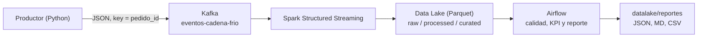
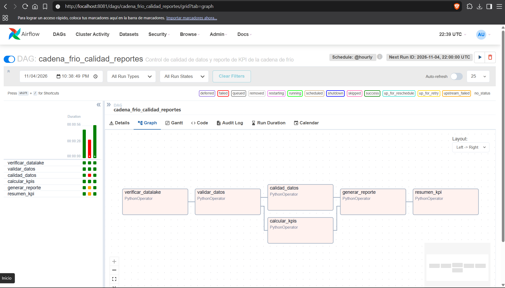

# RapidGo - Pipeline Big Data (Variante 3: Cadena de Frío)

**Equipo 7 — Integrantes:**
- Wilmer Leon
- Nicolas Martinez
- Yair Mora

**Universidad de Cundinamarca — Ingeniería de Sistemas y Computación — Big Data**

## 1. Objetivo del Proyecto

RapidGo es una plataforma de entregas que requiere monitorear productos sensibles. Este proyecto implementa un pipeline Big Data End-to-End para capturar eventos de temperatura y humedad durante el reparto, procesarlos en tiempo real y generar indicadores (KPI) y alertas cuando se presentan condiciones que pueden comprometer la cadena de frío.

## 2. Arquitectura del Pipeline

El flujo de datos implementado es el siguiente:

`Productor de Eventos (Python) -> Apache Kafka -> Spark Structured Streaming -> Data Lake (Parquet) -> Apache Airflow`



**Función de cada componente:**

- **Productor (Python):** genera eventos de temperatura y humedad asociados a un pedido. Envía un evento cada 2 segundos: ~80 % normales y ~20 % fuera de rango (para provocar alertas).
- **Kafka:** recibe y distribuye los eventos por el tópico `eventos-cadena-frio`. La clave del mensaje es `pedido_id` (ver `docs/decisions/ADR-001.md`).
- **Spark Structured Streaming:** consume los eventos, valida los datos, aplica transformaciones y calcula KPI y alertas.
- **Data Lake:** almacena los resultados en tres capas en formato Parquet: *raw* (tal como llega de Kafka), *processed* (eventos validados) y *curated* (KPI y alertas). Ver `datalake/README.md`.
- **Airflow:** orquesta la validación de datos, la calidad, el cálculo de KPI y la generación de reportes.

## 3. Organización del Repositorio

- `.github/workflows/`: automatización de validaciones mediante GitHub Actions.
- `airflow/`: DAG y lógica de calidad de datos y generación de reportes.
- `producer/`: generador de eventos.
- `spark/`: procesamiento en streaming y transformaciones (ver `spark/README.md`).
- `tests/`: pruebas automatizadas.
- `samples/`: ejemplos de eventos JSON (normal, fuera de rango e inválido).
- `datalake/`: almacenamiento local de datos en las capas raw, processed y curated.
- `docs/`: arquitectura, contrato del evento, KPI y alertas, calidad de datos, ADRs, checkpoints semanales y evidencias.
- `docker-compose.yml`: servicios del pipeline (Zookeeper, Kafka, Spark, Airflow).
- `requirements.txt`: dependencias de Python.

## 4. Requisitos Previos y Ejecución

**Requisitos:**

- Docker Desktop con Docker Compose v2.
- Python 3.12 (para el productor, las validaciones y las pruebas locales).
- Git.
- Conexión a internet la primera vez (Spark descarga el conector de Kafka y Airflow instala `pandas` y `pyarrow`).

Los comandos están en PowerShell (Windows); en Linux o macOS funcionan igual, salvo el comando de `Get-ChildItem`, que se reemplaza por `find datalake -name "*.parquet"`.

### 4.1. Preparar el proyecto

```powershell
git clone https://github.com/WiLLeonM/rapidgo-variant-3-cadena-frio.git
cd rapidgo-variant-3-cadena-frio
docker compose config -q
pip install -r requirements.txt
```

### 4.2. Levantar Kafka y crear el tópico

```powershell
docker compose up -d zookeeper kafka
docker compose exec kafka kafka-topics --create --if-not-exists --topic eventos-cadena-frio --bootstrap-server localhost:9092 --partitions 3 --replication-factor 1
```

### 4.3. Iniciar Spark Structured Streaming

```powershell
docker compose up -d spark-job
docker compose logs --tail=50 spark-job
```

Los mensajes `WARN` de los registros son advertencias de configuración, no errores.

### 4.4. Ejecutar el productor

En otra terminal, desde la carpeta del proyecto:

```powershell
python producer/producer.py
```

El productor publica un evento cada 2 segundos y mantiene el mismo `pedido_id` durante toda la ejecución. Dejarlo corriendo unos minutos y detenerlo con `Ctrl + C`.

### 4.5. Verificar el Data Lake

```powershell
Get-ChildItem .\datalake -Recurse -Filter *.parquet
```

Deben aparecer archivos en `datalake/raw/eventos/`, `datalake/processed/eventos/` y `datalake/curated/`. Para ver el contenido de los resultados:

```powershell
docker compose run --rm --no-deps spark-job /opt/spark/bin/spark-submit --master local[1] /app/spark/mostrar_resultados.py
```

Los resultados por ventana aparecen cuando el *watermark* cierra la ventana, por lo que conviene esperar unos minutos tras detener el productor.

### 4.6. Ejecutar Airflow

```powershell
docker compose up -d airflow
docker compose logs airflow
```

1. Abrir `http://localhost:8081` (la primera vez tarda unos minutos mientras instala dependencias).
2. Iniciar sesión con el usuario `admin`; la contraseña aparece en los registros, en el mensaje `Login with username`.
3. Activar el DAG `cadena_frio_calidad_reportes` y pulsar **Trigger DAG**.
4. El reporte queda en `datalake/reportes/` (JSON, Markdown y CSV).

Para apagar todo: `docker compose down`.

## 5. Contrato del Evento

El contrato oficial está definido en `docs/schemas/evento_cadena_frio.schema.json` y documentado en `docs/contrato_evento.md`. Ejemplo en `samples/evento_cadena_frio.json`.

Los campos principales son:

- `evento_id`: identificador único del evento.
- `pedido_id`: identificador del pedido, utilizado también como clave en Kafka.
- `vehiculo_id`: identificador del vehículo.
- `producto_tipo`: tipo de producto monitoreado (`producto_refrigerado`).
- `timestamp`: fecha y hora de generación del evento.
- `temperatura_c`: temperatura registrada en grados Celsius.
- `humedad_pct`: porcentaje de humedad registrado.

Los eventos que no cumplen el esquema se descartan en la validación (ejemplo en `samples/evento_invalido.json`).

## 6. Procesamiento, KPI y Alertas

Spark Structured Streaming realiza las siguientes operaciones:

- Parseo de los eventos recibidos desde Kafka.
- Validación de campos obligatorios, tipo de producto y valores físicamente posibles.
- Identificación de eventos fuera del rango permitido.
- Detección de temperaturas críticas.
- Cálculo de KPI por pedido y ventana de 5 minutos.
- Generación de alertas.

**Parámetros (provisionales, ver `docs/kpi_alertas.md`):**

| Parámetro | Valor |
|---|---|
| Temperatura permitida | 2 a 8 °C |
| Humedad permitida | 35 a 65 % |
| Temperatura crítica | ≥ 10 °C o ≤ 0 °C |
| Exposición prolongada | 10 minutos o más fuera de rango |

**KPI:** (1) tiempo acumulado fuera de rango, (2) duración de cada episodio fuera de rango, (3) porcentaje de tiempo dentro del rango.

**Alertas:** (1) temperatura crítica, (2) exposición prolongada.

## 7. Orquestación con Apache Airflow

El DAG `cadena_frio_calidad_reportes` (`airflow/dags/cadena_frio_calidad_dag.py`) ejecuta seis tareas:

```text
verificar_datalake -> validar_datos -> [calidad_datos, calcular_kpis] -> generar_reporte -> resumen_kpi
```

| Tarea | Función |
|---|---|
| `verificar_datalake` | Comprueba la existencia de datos Parquet (reintenta 4 veces si Spark aún no escribió). |
| `validar_datos` | Verifica columnas, nulos, valores imposibles, producto inválido y duplicados. |
| `calidad_datos` | Evalúa completitud, validez, unicidad y retención raw → processed; si no cumple los umbrales, el DAG falla. |
| `calcular_kpis` | Calcula los KPI y las alertas por pedido. |
| `generar_reporte` | Genera reportes JSON, Markdown y CSV. |
| `resumen_kpi` | Deja el resumen de resultados en el log de la tarea. |

Las tareas intercambian información mediante **XCom**; `retries` es 2 por defecto. La estrategia de recuperación ante fallos está en `docs/decisions/ADR-003.md` y las reglas de calidad en `docs/calidad_datos.md`.

## 8. Pruebas y Validación Continua

El proyecto usa `pytest` y validación de esquemas con `jsonschema`. Las pruebas están en `tests/`:

- `test_evento_schema.py`: contrato JSON.
- `test_reglas_negocio.py`: reglas de temperatura, humedad y exposición.
- `test_spark_transformaciones.py`: transformaciones de Spark (requiere Java).
- `test_calidad_datos.py`, `test_airflow_logica.py`, `test_airflow_dag.py`: calidad de datos y DAG.
- `test_productor.py`: eventos que genera el productor.

Ejecutar localmente:

```powershell
python -m pytest -v
```

GitHub Actions (`.github/workflows/ci.yml`) se ejecuta en `push`, `pull_request` y manualmente (`workflow_dispatch`) y realiza: Java 17 y Python 3.12, instalación de dependencias, validación de sintaxis, pruebas, validación de Docker Compose y validación de los DAGs de Airflow.

## 9. Variables de Configuración

| Variable | Valor predeterminado | Uso |
|---|---:|---|
| `MIN_CALIDAD_PCT` | 95 | Umbral mínimo de completitud, validez y unicidad |
| `MIN_RETENCION_PCT` | 90 | Umbral mínimo de retención raw → processed |
| `EXPOSICION_MINUTOS` | 10 | Minutos fuera de rango para la alerta de exposición prolongada |
| `MUESTREO_SEGUNDOS` | 2 | Segundos entre eventos de un mismo pedido |
| `MAX_INTERVALO_SEGUNDOS` | 300 | Intervalo máximo considerado entre eventos |

Las variables de Spark se describen en `spark/README.md`.

## 10. Resultados de la Ejecución Final

Ejecución de integración del 11 de noviembre de 2026 (detalle y capturas en `docs/evidencia/Evidencias_integracion_end_to_end_semana_4.pdf`):

| Indicador | Resultado |
|---|---|
| Eventos procesados (`processed/eventos`) | 208 |
| Pedidos distintos | 1 |
| Nulos, valores imposibles y duplicados | 0 |
| Completitud, validez y unicidad | 100 % (umbral 95 %) |
| Retención raw → processed | 100 % (208 → 208; umbral 90 %) |
| Minutos acumulados fuera de rango (KPI 1) | 1,24 |
| Episodios fuera de rango | 27 (duración máxima 0,13 min) |
| Tiempo dentro de rango (KPI 3) | 82,23 % |
| Alertas de temperatura crítica | 37 |
| Alertas de exposición prolongada | 0 |
| Estado de calidad | APROBADO |

GitHub Actions: ejecución #50 completada correctamente. Docker Compose: los seis servicios en estado `Up`.



Otras evidencias: `docs/evidencia/reporte_cadena_frio_2026-11-04.md` (primera ejecución del DAG, Semana 3) y `docs/checkpoints/` (checkpoints semanales).

## 11. Limitaciones Conocidas

- La ejecución final monitorizó **un solo pedido**, porque el productor mantiene el mismo `pedido_id` durante cada ejecución.
- La alerta de **exposición prolongada** no se activó en la ejecución final; no se realizó una prueba controlada de esa condición.
- Los umbrales de temperatura, humedad y exposición son **provisionales** (`docs/kpi_alertas.md`).
- Los resultados por ventana aparecen cuando el *watermark* cierra la ventana; la última ventana necesita eventos posteriores para verse.
- Mientras una exposición continúa, la alerta de exposición prolongada puede repetirse en cada ventana.
- El entorno es local: un solo broker de Kafka (factor de replicación 1), Spark en modo `local` dentro del contenedor y Airflow en modo `standalone`.
- Airflow genera la contraseña de `admin` al arrancar, por lo que se consulta en los registros.

## 12. Contribuciones del Equipo

| Semana | Issue | Aporte | Responsable |
|---|---|---|---|
| 3 | [#8](https://github.com/WiLLeonM/rapidgo-variant-3-cadena-frio/issues/8) | DAG de Airflow para calidad y reportes de cadena de frío | Nicolas Martinez |
| 3 | [#9](https://github.com/WiLLeonM/rapidgo-variant-3-cadena-frio/issues/9) | Prueba de recuperación ante fallos, ampliación del CI y ADR-003 | Yair Mora |
| 3 | [#10](https://github.com/WiLLeonM/rapidgo-variant-3-cadena-frio/issues/10) | Validación de calidad de datos y métricas de operación | Wilmer Leon |
| 4 | [#11](https://github.com/WiLLeonM/rapidgo-variant-3-cadena-frio/issues/11) | Integración y estabilización del pipeline end-to-end | Wilmer Leon |
| 4 | [#12](https://github.com/WiLLeonM/rapidgo-variant-3-cadena-frio/issues/12) | README final, cierre de pendientes y release v1.0.0 | Nicolas Martinez |
| 4 | [#13](https://github.com/WiLLeonM/rapidgo-variant-3-cadena-frio/issues/13) | Pruebas finales, evidencias y demostración (en curso) | Yair Mora |

- Todos los Issues (semanas 1 a 4): [lista de Issues](https://github.com/WiLLeonM/rapidgo-variant-3-cadena-frio/issues?q=is%3Aissue)
- Todos los Pull Requests: [lista de Pull Requests](https://github.com/WiLLeonM/rapidgo-variant-3-cadena-frio/pulls?q=is%3Apr)

## 13. Entrega Final

- **Release v1.0.0:** https://github.com/WiLLeonM/rapidgo-variant-3-cadena-frio/releases/tag/v1.0.0
- **Video final (máximo 10 minutos):** ENLACE_DEL_VIDEO
